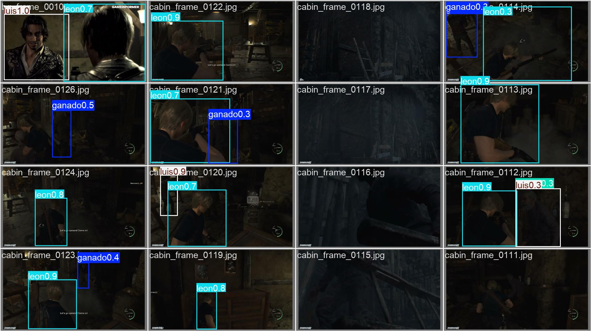
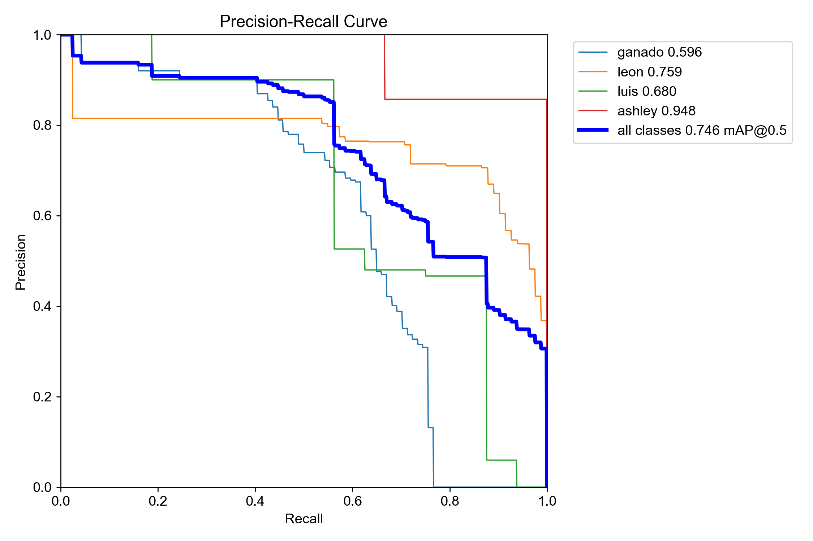
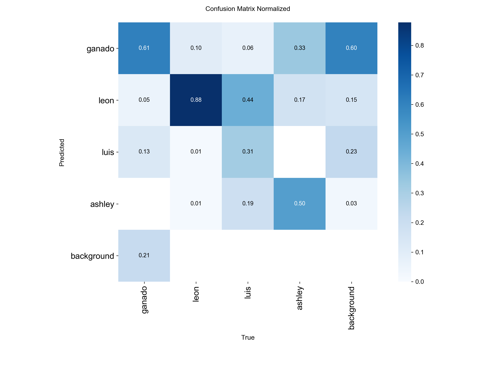
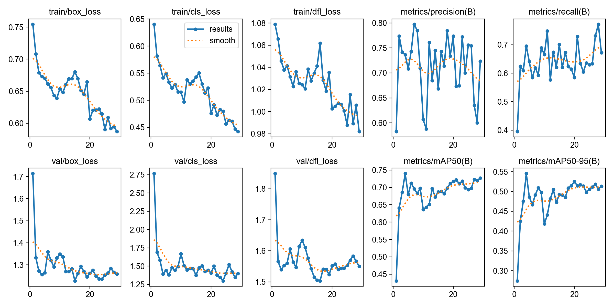
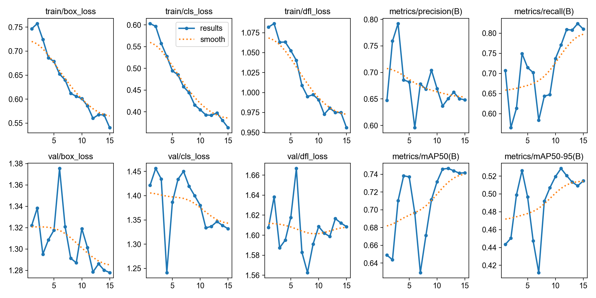

# Resident Evil 4 Enemy Detection & Multi-Object Tracking (YOLOv8)

An end-to-end computer vision object detection and multi-object tracking pipeline built with [Ultralytics YOLOv8](https://docs.ultralytics.com/) and accelerated on Apple Silicon (`mps`) to detect and track enemies (**Ganados**) in 60 FPS *Resident Evil 4* gameplay footage across low-light, long-range, and visually cluttered scenes.



---

## 1. Project Overview & Problem Statement

Standard pretrained object detectors fail on third-person survival-horror gameplay due to four domain-specific challenges:

1. **Severe Low-Light Conditions**: Indoor siege scenes (such as the village cabin) and night stages obscure enemy silhouettes and suppress edge contrast.
2. **Distant Small Objects in 1080p Widescreen**: Enemies approaching from afar occupy less than `1.5%` of the frame width, shrinking to <10 pixels when downscaled to standard `640×640` inputs.
3. **High Silhouette Overlap with Player & Allies**: The third-person player character (**Leon**) and friendly NPCs (**Luis**, **Ashley**) share humanoid proportions and weapons with **Ganados**, causing single-class detectors to either misclassify allies as enemies or suppress humanoid detections altogether.
4. **Environmental False Positives**: High-contrast vertical cabin beams, dark doorways, and tree trunks frequently trigger false alarms that lock into multi-frame trackers.

---

## 2. Iterative Engineering & Results Progression

Across 14 training iterations, this project applied a **Data-Centric AI** workflow—auditing train/validation leakage, rebalancing negative background priors, automating multi-class ally annotation, mining hard negatives, and decoupling Mosaic training from full-frame boundary calibration ([YOLO Performance Metrics](https://docs.ultralytics.com/guides/yolo-performance-metrics)).

| Run | Model & Key Configuration | Dataset & Taxonomy Changes | Peak `mAP50` | Peak `mAP50-95` | Peak Recall | `val/box_loss` | `val/cls_loss` | Engineering Diagnosis & Outcome |
| :--- | :--- | :--- | :---: | :---: | :---: | :---: | :---: | :--- |
| **`train-7`** *(Initial)* | `yolov8n.pt` (`imgsz=640`), 1 class (`ganado`) | Leaked split (`train` = `val`), 64% negative frames | `0.940`* | `0.618`* | `0.870`* | `1.038` | `1.092` | *Inflated by train/val leakage; 587 unlabeled player frames suppressed real-video recall. |
| **`train-8`** *(Failure Case)* | `yolov8s.pt` (`imgsz=960`), `rect=True`, `batch=4`, `optimizer='auto'` | Leak-free split (`430` train / `135` val) | `0.002` | `0.0004` | `0.289` | `2.681` | `30.940` | `rect=True` disabled dataset shuffling and Mosaic ([Issue #21730](https://github.com/ultralytics/ultralytics/issues/21730)); `auto` forced `lr0=0.002`, causing BatchNorm divergence. |
| **`train-10`** *(Baseline)* | `yolov8s.pt` (`imgsz=768`), `rect=False`, `AdamW` (`lr0=0.0005`), `CLAHE` | Leak-free split (`430` train / `135` val), 1 class | `0.536` | `0.233` | `0.544` | `1.954` | `2.229` | First true unseen validation baseline; struggled with false positives on Leon, Luis, and Ashley. |
| **`train-11`** | Fine-tuned `train-10/best.pt`, 50 epochs | **4 classes** (`ganado`, `leon`, `luis`, `ashley`) via `yolov8x.pt` auto-labeling | `0.654` | `0.469` | `0.648` | `1.149` | `1.342` | Multi-class disentanglement cut validation losses by ~40% and **doubled `mAP50-95`** (+101%). |
| **`train-12`** | Fine-tuned `train-11/best.pt`, `lr0=0.0002`, `close_mosaic=5` | Added 84 curated hard-negative frames (`b_frame_1`–`84`) | `0.736` | `0.535` | `0.770` | `1.193` | `1.236` | Hard-negative mining boosted `mAP50` by +8.2 points and Recall by +12.2 points. |
| **`train-13`** | Fine-tuned `train-12/best.pt`, `CLAHE(clip_limit=2.0, p=0.25)` | Softened low-light contrast to reduce wall false alarms | `0.740` | **`0.545`** | `0.772` | `1.228` | `1.299` | Reached peak tight box localization (`0.545 mAP50-95`, **+134% over baseline**). |
| **`train-14`** *(Final)* | Fine-tuned `train-13/best.pt`, `close_mosaic=15`, `warmup_epochs=0` | 15 full epochs of un-stitched clean frames (`patience=0`) | **`0.747`** | `0.529` | **`0.824`** | `1.278` | `1.241` | Final mosaic-free calibration pushed unseen enemy **Recall to 82.4%** (+51% over baseline) and **`mAP50` to 0.747** (+39%). |

---

## 3. Key Technical Highlights

### Semi-Supervised Multi-Class Disentanglement (`scripts/autolabeling.py`)
In a single-class (`0: ganado`) setup, unlabeled allies act as conflicting negative priors while labeled enemies teach the detector to fire on any humanoid silhouette. To resolve this without re-annotating 565 frames by hand:
- Ran a COCO-pretrained `yolov8x.pt` (`person` class) detector across the dataset ([Ultralytics Configuration](https://docs.ultralytics.com/usage/cfg)).
- Filtered candidate detections using Intersection over Union (`IoU < 0.20`) against existing ground-truth `ganado` boxes so only unannotated human figures (`leon`, `luis`, `ashley`) were added.
- Training on the 4-class schema forced the decoupled classification head to learn character-specific visual features (Leon's jacket/vest from behind, Luis's patterned vest, Ashley's outfit), cutting `val/cls_loss` from `2.229` to `1.342`.

### Post-NMS Class-Agnostic Suppression & 60 FPS ByteTrack (`predict.py`)
Passing `classes=[0]` directly into `model.track()` discards ally predictions (`1: leon`, `2: luis`, `3: ashley`) *before* Non-Maximum Suppression (NMS), allowing secondary low-confidence `0: ganado` scores on allies to survive unchallenged.
- **Solution**: Enabled `agnostic_nms=True` across all 4 classes during `model.track()` ([Ultralytics Multi-Object Tracking](https://docs.ultralytics.com/modes/track)) so high-confidence ally predictions (`0.85+`) actively suppress overlapping false `ganado` boxes on the same character, then filtered to `r.boxes.cls == 0` prior to rendering.
- **Hardware Acceleration**: Routed inference to Apple Silicon Metal (`device='mps'`) at matched training resolution (`imgsz=768`) with dynamic source FPS detection (`cv2.CAP_PROP_FPS`), accelerating 13,000-frame video processing by **15×–25×** at native 60 FPS.

### Low-Light Augmentation & Two-Stage Full-Frame Calibration (`train.py`)
- Integrated Albumentations `A.CLAHE` ([Ultralytics Data Augmentation](https://docs.ultralytics.com/guides/yolo-data-augmentation)) with `hsv_v` adjustments and `scale=0.6` at `imgsz=768` to preserve distant enemy pixel density and dark interior contrast.
- Diagnosed an early-stopping interaction where `warmup_bias_lr=0.1` spiked bias learning rates (`lr/pg2 = 0.067`) when fine-tuning converged checkpoints, solving it in `train-14` with a dedicated `close_mosaic=15`, `warmup_epochs=0`, `patience=0` pass.

---

## 4. Evaluation Curves & Visual Results

| Precision-Recall Curve (`train-14`) | Normalized Confusion Matrix (`train-14`) |
| :---: | :---: |
|  |  |

| Mosaic Training Convergence (`train-13`) | Clean Full-Frame Calibration (`train-14`) |
| :---: | :---: |
|  |  |

---

## 5. Repository Structure

```text
├── data.yaml                          # 4-class dataset configuration (ganado, leon, luis, ashley)
├── train.py                           # YOLOv8s fine-tuning script (MPS, AdamW, close_mosaic)
├── predict.py                         # 60 FPS ByteTrack + post-NMS class-agnostic inference pipeline
├── requirements.txt                   # Python dependencies
├── scripts/
│   └── autolabeling.py                # Semi-supervised YOLOv8x + IoU filtering pre-labeling script
├── weights/
│   └── best.pt                        # Final fine-tuned YOLOv8s checkpoint (train-14)
├── results/                           # Validation curves, confusion matrix, and batch predictions
│   ├── BoxPR_curve.png
│   ├── confusion_matrix_normalized.png
│   ├── train13_results.png
│   ├── train14_results.png
│   └── val_batch0_pred.jpg
└── sessions/                          # Detailed daily engineering & debugging logs
    ├── 2026-10-14-session-recap.md
    └── 2026-10-15-session-recap.md
```

---

## 6. Quickstart: Installation & Usage

### 1. Install Dependencies
```bash
pip install -r requirements.txt
```

### 2. Run 60 FPS Video Tracking Inference
Place an input gameplay video (e.g., `re4_run2.mp4`) in the project root and update the weight path in `predict.py` to `weights/best.pt`:
```bash
python predict.py
```
The tracked output video with ally boxes suppressed via class-agnostic NMS is saved to `runs/detect/re4_run2_clean.mp4`.

### 3. Fine-Tune or Train on Custom Gameplay Frames
Organize training and validation frames under `images/train`, `images/val`, `labels/train`, and `labels/val` as specified in `data.yaml`, then run:
```bash
python train.py
```
